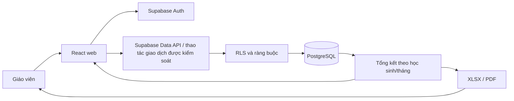

# ARCHITECTURE — Kiến trúc ứng dụng

**Trạng thái:** Đề xuất kỹ thuật, chưa triển khai · **Nguồn nghiệp vụ:** [PRD.md](PRD.md) · **Kế hoạch nền:** [KE_HOACH_PHAT_TRIEN_APP_LICH_HOC_HOC_PHI.md](../KE_HOACH_PHAT_TRIEN_APP_LICH_HOC_HOC_PHI.md)

## 1. Lựa chọn công nghệ

| Tầng | Công nghệ dự kiến | Vai trò |
|---|---|---|
| Web | TypeScript, React, Vite | Giao diện responsive và logic hiển thị. |
| Dữ liệu | Supabase PostgreSQL, migration SQL | Lưu dữ liệu có quan hệ, ràng buộc, tổng hợp tháng. |
| Xác thực | Supabase Auth | Đăng nhập giáo viên. |
| Phân quyền | PostgreSQL Row Level Security (RLS) | Cô lập dữ liệu theo giáo viên ngay tại database. |
| Hosting | Cloudflare Workers Static Assets | Phục vụ bản build tĩnh; không cần máy chủ React riêng trong bản đầu. |
| Xuất file | Thư viện TypeScript XLSX/PDF được chọn khi làm task xuất file | Cùng một dữ liệu bảng kê tạo màn hình và file; PDF phải có font Unicode tiếng Việt. |

Đây là **hướng triển khai**, không phải mô tả hệ thống đã chạy. So sánh phương án Firebase và giới hạn miễn phí có dẫn nguồn trong [kế hoạch](../KE_HOACH_PHAT_TRIEN_APP_LICH_HOC_HOC_PHI.md). Trước khi dùng dữ liệu thật phải kiểm tra lại điều khoản và quota hiện hành.

## 2. Nguyên tắc kiến trúc

1. **Tách lịch và tiền:** `sessions` là ghi chú lịch; `session_students` lưu kết quả thực học, giá và tiền của từng em. Mục lịch dự kiến luôn chưa phát sinh học phí.
2. **Một nguồn tính toán:** Công thức tiền được định nghĩa tại miền nghiệp vụ; database áp ràng buộc số nguyên, trạng thái và quyền truy cập. Tổng tháng tính từ dòng đã chốt và giao dịch gốc, không lưu tổng tháng nhập tay.
3. **Một buổi, nhiều em:** Mỗi cặp `(session_id, student_id)` chỉ có một dòng; mỗi em có thời lượng và giá riêng. Một buổi nhóm không biến thành một khoản tiền chung.
4. **Lịch chồng giờ là hợp lệ:** Kiểm tra giao nhau để cảnh báo trên UI; không tạo ràng buộc database cấm chồng. Cảnh báo phải phân biệt trùng cùng học sinh và trùng giữa các em.
5. **Lịch sử tài chính có dấu vết:** Giá đã chốt là snapshot. Sửa sau chốt cần lý do và bản ghi audit/điều chỉnh; không xóa cứng dòng đã tính tiền.
6. **Giáo viên là người dùng duy nhất:** Không tạo cổng phụ huynh/học sinh; dữ liệu vẫn cô lập theo tài khoản giáo viên để có thể mở rộng sau.

## 3. Luồng dữ liệu



**Đặt lịch:** giáo viên nhập giờ bắt đầu/phút dự kiến/hình thức/danh sách em → kiểm tra trùng giờ để cảnh báo → lưu `sessions` và các dòng `session_students` trạng thái dự kiến trong một giao dịch. **Xác nhận học:** giáo viên ghi thực tế từng em → lấy đơn giá có hiệu lực hoặc giá riêng được nêu rõ → tính và chốt tiền từng dòng một cách nguyên tử. **Tổng kết:** lọc dòng đã học theo tháng của giờ bắt đầu thực tế theo Việt Nam → cộng điều chỉnh → trừ tiền đã nhận/hoàn → hiển thị và xuất từ cùng bộ dữ liệu.

## 4. Mô hình dữ liệu dự kiến

| Bảng | Khóa/trường chính | Quan hệ và kiểm tra |
|---|---|---|
| `profiles` | `id` = ID Auth, `display_name` | Một giáo viên sở hữu hồ sơ, lịch và giao dịch. |
| `students` | `id`, `owner_id`, tên, liên hệ, trạng thái | `owner_id → profiles.id`; không cho đọc chéo tài khoản. |
| `rate_history` | `id`, `student_id`, `effective_from`, `rate_vnd_per_hour` | Giá nguyên không âm; mỗi thời điểm hiệu lực của một em là duy nhất. |
| `sessions` | `id`, `owner_id`, `planned_start_at`, `planned_minutes`, hình thức, địa điểm/URL, ghi chú, `deleted_at` | Thời điểm lưu dưới dạng instant/UTC; hiển thị theo Việt Nam. `deleted_at` chỉ dùng cho lịch chưa chốt. |
| `session_students` | `id`, `session_id`, `student_id`, `status`, `actual_start_at`, `actual_minutes`, `rate_snapshot_vnd_per_hour`, `charge_vnd`, `makeup_for_id` | Một em tối đa một dòng/buổi; chỉ `completed` có tiền học. Ràng buộc em và buổi cùng chủ sở hữu. |
| `fee_adjustments` | `id`, `student_id`, `session_student_id`, kỳ tháng, `amount_vnd`, lý do | Số tiền có dấu; ghi nhận khoản phát sinh hoặc hiệu chỉnh. |
| `payments` | `id`, `student_id`, kỳ tháng, ngày nhận, `amount_vnd`, loại nhận/hoàn, phương thức | Giao dịch tiền tách khỏi khoản phải thu; không ghi đè số đã thu. |
| `audit_events` | đối tượng, ID đối tượng, thao tác, trước/sau, người làm, thời điểm, lý do | Theo dõi sửa/xóa lịch và đặc biệt mọi thay đổi đã chốt. |

**Trạng thái dòng học sinh:** `scheduled`, `completed`, `cancelled`, `absent`. Buổi nhóm có thể đồng thời có em `completed` và em `absent`. Trạng thái của `sessions` trên UI có thể suy ra từ các dòng con; tránh một trạng thái buổi áp đặt sai cho cả nhóm.

**Ràng buộc quan trọng:** `planned_minutes` và `actual_minutes` là số nguyên dương khi có giá trị; giá và tiền là số nguyên VND không âm; `actual_start_at` và `actual_minutes` bắt buộc khi hoàn thành; URL chỉ cần khi học online nếu giáo viên có liên kết; cặp `(session_id, student_id)` duy nhất. Dữ liệu bị xóa mềm không xuất hiện trong lịch thường.

## 5. Thời gian và công thức tiền

- Lưu thời điểm có múi giờ bằng kiểu phù hợp cho instant; mọi phân kỳ tháng và file xuất dùng `Asia/Ho_Chi_Minh`. Khi một em vào muộn trong buổi nhóm, tháng tính theo **giờ bắt đầu thực tế của em**.
- Tiền của dòng đã học: `floor((rate_vnd_per_hour × actual_minutes + 30) / 60)` với số nguyên không âm. Không tính từ phút dự kiến và không cộng tiền bằng số thực.
- `charge_vnd` là kết quả chốt từng dòng. Việc chốt/sửa phải kiểm tra trạng thái, đơn giá có hiệu lực, quyền sở hữu và lưu audit trong cùng giao dịch; không để frontend tự ghi một số tiền tùy ý mà thiếu kiểm tra.
- Báo cáo học sinh/tháng = tổng `charge_vnd` của dòng `completed` trong tháng + điều chỉnh cùng kỳ − tiền nhận cùng kỳ + tiền hoàn cùng kỳ. Nếu biểu thức âm do chỉnh sửa sau thanh toán, hiển thị khoản cần đối soát thay vì âm thầm gọi là “còn phải thu”.

## 6. Phân quyền và bảo mật

- RLS cho tất cả bảng dữ liệu; `anon` không đọc dữ liệu. Chỉ tài khoản giáo viên đã đăng nhập truy cập hàng do mình sở hữu hoặc hàng con thuộc hồ sơ mình sở hữu.
- Quyền sở hữu được xác minh ở database cả khi thêm học sinh vào buổi nhóm. Không dựa riêng vào việc ẩn nút trên giao diện. Kiểm thử hai giáo viên A/B cho đọc, tạo, sửa, xóa trên từng bảng.
- Khóa công khai của Supabase có thể nằm ở client cùng với RLS; **service role key, mật khẩu và chuỗi kết nối quản trị tuyệt đối không được đưa vào frontend/repository**.
- Xuất file chỉ dùng dữ liệu vừa được phép truy cập. File đã tải về thuộc trách nhiệm bảo quản/gửi của giáo viên.
- Sao lưu dữ liệu định kỳ và thử khôi phục trước khi dùng dữ liệu thật; gói miễn phí không thay thế kế hoạch backup.

## 7. Cấu trúc thư mục khi bắt đầu xây dựng

```text
lich-hoc-hoc-phi/
├── .codex/
│   ├── PRD.md
│   ├── ARCHITECTURE.md
│   ├── DESIGN.md
│   ├── RULES.md
│   ├── TASKS.md
│   └── PROGRESS.md
├── web/
│   ├── public/
│   ├── src/
│   │   ├── app/                 # Khởi tạo, route, layout
│   │   ├── features/
│   │   │   ├── auth/
│   │   │   ├── students/
│   │   │   ├── calendar/
│   │   │   ├── sessions/        # Mục lịch/học nhóm
│   │   │   ├── attendance/      # Thực học và tiền theo em
│   │   │   ├── monthly-summary/
│   │   │   ├── payments/
│   │   │   └── exports/
│   │   ├── domain/              # Quy tắc tiền, ngày giờ, trạng thái
│   │   ├── shared/              # UI và định dạng dùng chung
│   │   └── lib/                 # Kết nối, cấu hình
│   └── tests/
├── supabase/
│   ├── migrations/
│   └── tests/
└── docs/
    ├── decisions.md            # Quyết định đã duyệt và ngày chốt
    └── release-checklist.md
```

Chỉ tạo các thư mục khi task tương ứng bắt đầu. Sáu file Markdown này là tài liệu điều phối trong `.codex/`; không cần sao chép nội dung sang nhiều nơi.

## 8. Triển khai theo giai đoạn

Giai đoạn 1 chạy local với dữ liệu thử: Auth, hồ sơ/giá học sinh, lịch và RLS. Các giai đoạn sau mới thêm chốt tiền, báo cáo, file và phát hành. Khi phát hành, build Vite thành tài nguyên tĩnh, triển khai lên Cloudflare và cấu hình Supabase; kiểm tra đăng nhập, quyền, timezone, xuất file, quota và khôi phục. Trình tự và điều kiện hoàn thành nằm ở [TASKS.md](TASKS.md).
